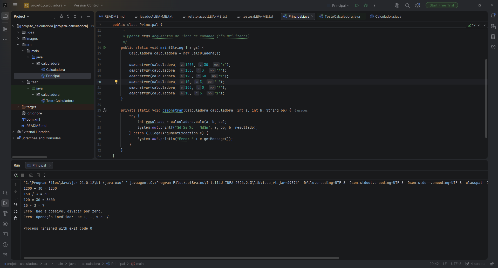
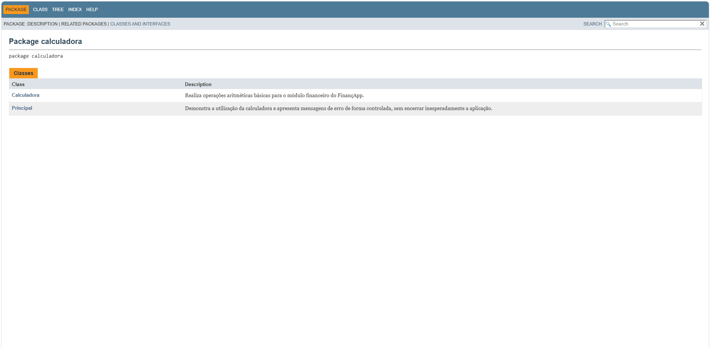
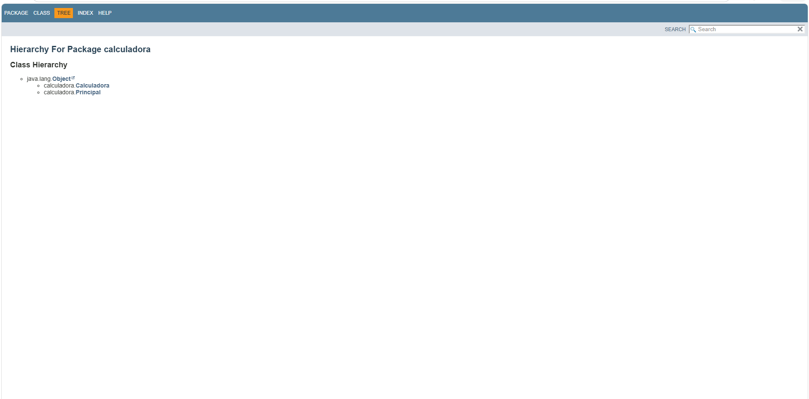
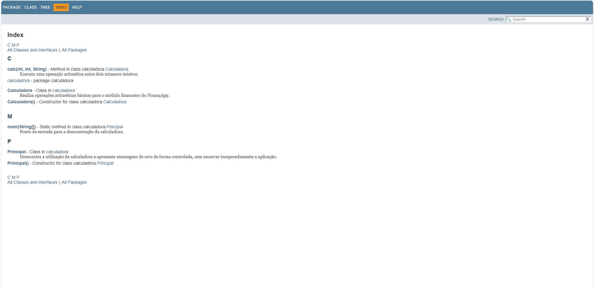
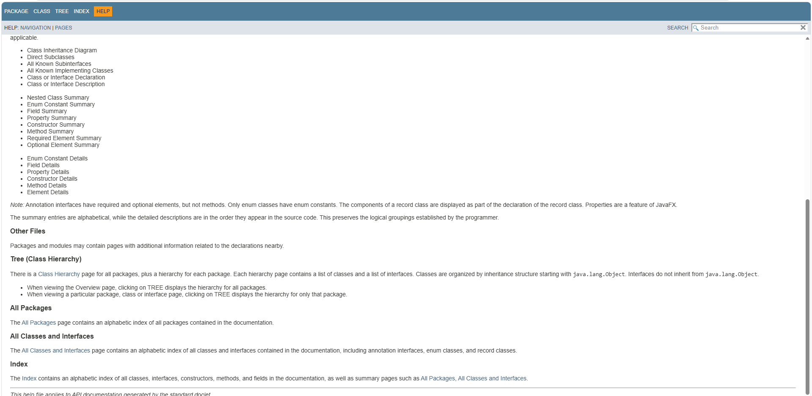

# Projeto Calculadora — FinançApp

> Projeto acadêmico desenvolvido em Java com foco em qualidade de software, testes unitários, refatoração, documentação JavaDoc e versionamento.

---

## 1. Identificação do Projeto

- **Projeto:** Projeto Calculadora
- **Contexto:** FinançApp
- **Aluno:** Eduarda de Almeida Miranda
- **RA:** 249607
- **Curso:** Análise e Desenvolvimento de Sistemas
- **Disciplina:** UX/UI e Testes de Software
- **Professor:** Daniel Ohata
- **Semestre:** 2026.2
- **Repositório GitHub:**  https://github.com/edkrda/projeto_calculadora

## 2. Visão Geral

O projeto implementa um módulo de cálculos matemáticos básicos para a startup fictícia FinançApp. O módulo pode servir de base para funcionalidades de orçamento mensal, divisão de despesas, projeção de economias e cálculos financeiros auxiliares.

A atividade contempla implementação, validação de entradas, testes automatizados, refatoração, documentação técnica e versionamento com Git e GitHub.

## 3. Objetivo da Atividade

Desenvolver a classe `Calculadora` em Java, garantindo o funcionamento das quatro operações fundamentais e aplicando práticas de qualidade de software.

Objetivos específicos:

- implementar soma, subtração, multiplicação e divisão;
- tratar divisão por zero e operadores inválidos;
- validar o comportamento por meio de testes unitários;
- refatorar o código sem prejudicar o comportamento esperado;
- documentar classes e métodos com JavaDoc;
- gerar a documentação em HTML;
- organizar o projeto com Git, branches e commits;
- registrar as evidências de teste e documentação neste README.

## 4. Tecnologias Utilizadas

| Tecnologia | Utilização |
|---|---|
| Java 17 | Linguagem de programação |
| Maven | Gerenciamento do projeto e execução dos testes |
| JUnit 5 | Testes unitários |
| IntelliJ IDEA | Ambiente de desenvolvimento |
| Git | Controle de versão |
| GitHub | Hospedagem do repositório |
| JavaDoc | Geração da documentação HTML |

## 5. Operações Implementadas

A classe principal está no pacote `calculadora` e disponibiliza o método `calc(int a, int b, String op)`. O atributo `r` armazena o resultado da última operação concluída com sucesso.

| Operador | Operação | Exemplo | Resultado |
|---|---|---|---:|
| `+` | Adição | `10 + 5` | 15 |
| `-` | Subtração | `10 - 5` | 5 |
| `*` | Multiplicação | `10 * 5` | 50 |
| `/` | Divisão inteira | `20 / 5` | 4 |

### Tratamento de erros

- A divisão por zero gera `IllegalArgumentException` com mensagem informativa.
- Operadores diferentes de `+`, `-`, `*` e `/` são rejeitados com mensagem clara.
- Um operador nulo também é rejeitado.
- A classe `Principal` demonstra como capturar essas exceções e exibir mensagens sem encerrar inesperadamente a demonstração.
- O resultado anterior só é atualizado quando uma operação é concluída com sucesso.

**Observação:** como o método recebe e retorna `int`, a divisão é inteira. Por exemplo, `10 / 3` retorna `3`.

## 6. Estrutura do Projeto

```text
projeto_calculadora_financapp/
├── src/
│   ├── main/
│   │   └── java/
│   │       └── calculadora/
│   │           ├── Calculadora.java
│   │           └── Principal.java
│   └── test/
│       └── java/
│           └── calculadora/
│               └── TesteCalculadora.java
├── docs/                  # Gerada pelo comando JavaDoc
├── pom.xml
├── .gitignore
└── README.md
```

## 7. Como Executar no IntelliJ IDEA

1. Extraia o projeto e abra a pasta que contém o arquivo `pom.xml` no IntelliJ IDEA.
2. Selecione um JDK 17 ou superior compatível e permita que o IntelliJ carregue o projeto Maven.
3. Abra a janela **Maven** e recarregue o projeto, se necessário.
4. Execute os testes pela classe `TesteCalculadora` ou pelo painel Maven em **Lifecycle → test**.
5. Para executar a demonstração, abra `Principal.java` e clique no ícone de execução ao lado do método `main`.

Comandos Maven, executados no terminal integrado na pasta do projeto:

```bash
mvn clean test
```

Para executar a demonstração pela linha de comando após compilar:

```bash
mvn -q -DskipTests package
java -cp target/classes calculadora.Principal
```

## 8. Testes Unitários

A classe `TesteCalculadora` verifica:

- soma;
- subtração;
- multiplicação;
- divisão;
- divisão inteira;
- números negativos;
- divisão por zero;
- operador inválido;
- operador nulo;
- preservação do último resultado válido após uma operação inválida.

### Evidência da execução dos testes





## 9. Processo de Refatoração

A atividade exige uma branch chamada `Refatoracao`. O processo deve preservar o comportamento funcional e manter os testes aprovados.

Práticas aplicadas na versão refatorada:

- uso de `switch` para organizar a seleção do operador;
- validação explícita de operador nulo;
- mensagem específica para divisão por zero;
- exceções informativas para entradas inválidas;
- separação entre a lógica da calculadora, a demonstração e os testes;
- documentação JavaDoc nas classes e métodos públicos.

Após a refatoração, execute novamente:

```bash
mvn clean test
```

### Evidência da refatoração

Salve um print real do histórico do Git mostrando a branch `Refatoracao` e os commits correspondentes em `images/refatoracao/`.


## 10. Documentação JavaDoc

As classes e os métodos públicos possuem comentários JavaDoc. Para gerar a documentação HTML, execute na raiz do projeto:

```bash
mvn javadoc:javadoc
```

A documentação será gerada em:

```text
target/reports/apidocs/index.html
```

Para gerar a documentação dentro da pasta `docs`, execute:

```bash
mvn javadoc:javadoc -DreportOutputDirectory=docs
```

Se a versão do plugin ou a configuração local não respeitar o diretório informado, consulte o resultado exibido pelo Maven e ajuste o caminho de saída. Abra o arquivo `index.html` gerado no navegador para conferir a documentação.

### Evidência da documentação JavaDoc
**Imagem 1 — Página inicial da documentação JavaDoc**



**Imagem 2 — Documentação da classe Calculadora**



**Imagem 3 — Documentação dos métodos**



**Imagem 4 — Detalhes da documentação**



## 11. Versionamento com Git e GitHub

O repositório deve conter pelo menos as branches:

- `main`: versão principal do projeto;
- `Refatoracao`: versão refatorada, com testes repetidos e documentação atualizada.


## 12. Conclusão

A atividade reúne conceitos essenciais de desenvolvimento de software: implementação de funcionalidades, tratamento de erros, testes automatizados, refatoração, documentação técnica e versionamento. A calculadora é um módulo pequeno, mas demonstra a importância de validar o comportamento do código e registrar as mudanças realizadas.

## 13. Repositório

**Link do GitHub:** https://github.com/edkrda/projeto_calculadora


